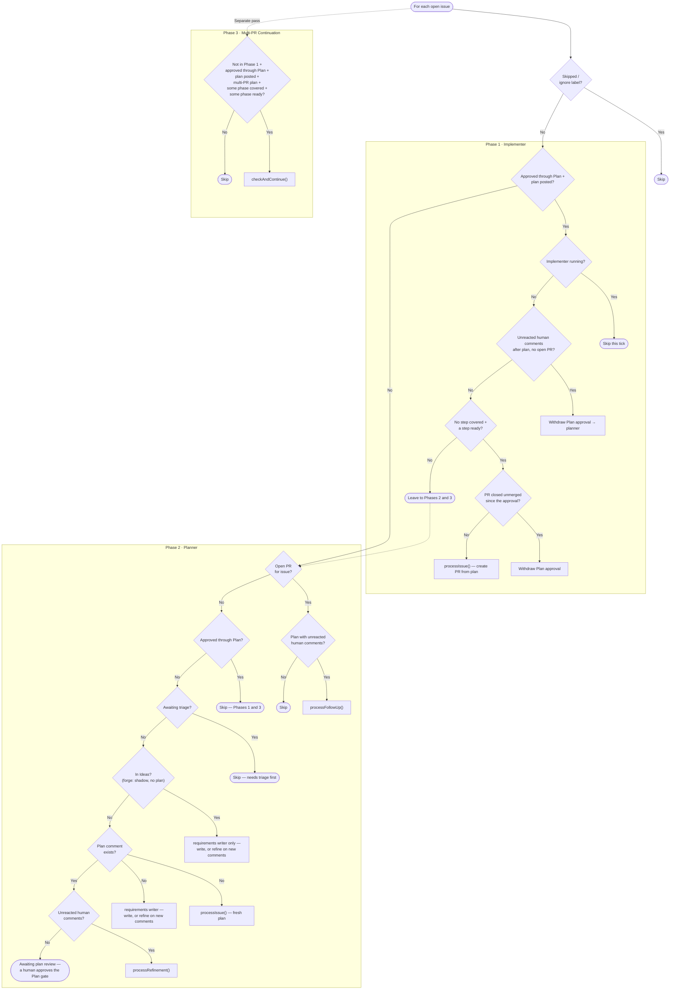

# issue-dispatcher

**Deep dive.** Read this when you're changing issue planning, refinement,
duplicate handling, or implementation dispatch. For PR-side automation, read
pr-dispatcher.md instead.

Product requirements: [product/automation-lifecycle.md](../product/automation-lifecycle.md)

**Source**: `src/jobs/issue-dispatcher.ts`
**Interval**: 5 minutes (configurable via `intervals.issueDispatcherMs`)

Each repo's cycle opens with the **dependency sweep** (`issue-links.ts`'s `releaseDependencyParkedIssues`): every Blocked native issue whose primary repo this is, and whose unreleased "depends on" links all point at closed issues, is moved out of Blocked with a comment naming the dependencies that cleared — to Awaiting plan review when it has a real plan, to Planning with an `issue-refiner:replan` enqueued when its last plan is the planner's blocked verdict, and, when it has none, to Planning for the next cycle to plan if its requirements were approved and to Ideas otherwise. The links are then stamped released, so a human who re-parks the issue later is not undone. A sweep failure is reported and never costs the repo its cycle; released issues are skipped by Phases 2 and 3 this tick. See [issue-tracker.md#links](../issue-tracker.md#links).

Beside it runs the **Backlog return sweep** (`backlog-until.ts`'s `releaseDueBacklogIssues`): every open native issue whose primary repo this is, parked in the Backlog with a `backlog_until` day on or before today's UTC date, is moved to where a Promote lands it (`clawsIssues.entryLifecycle`) — the write clears the date. One with a plan gets `issue-refiner:verify` enqueued (see [Backlog return](#backlog-return-verify-stage)); one without is announced at once (an issue comment and a Slack line) and planned by Phase 2 as usual; with the planner disabled a planned issue goes straight to Awaiting plan review, announced as unverified. Same footing as the dependency sweep: a failure is reported under `issue-dispatcher:release-backlog`, never costs the cycle, and released issues skip Phases 2 and 3 this tick. See [issue-tracker.md#parking-until-a-date](../issue-tracker.md#parking-until-a-date).

### Import first

In a repo with `issue-importer` enabled, a forge issue is imported into the
native tracker before any agent acts on it (#clw_01M52GPG0E9DP8RQKW6ABH0X7R).
After the two sweeps, and before the listing, the cycle runs one importer pass
for the repo (`issue-importer.ts`'s `importNewIssues`), so a forge issue is
imported within one tick of Claws first seeing it rather than on the importer's
30-minute timer. A failure is reported under `issue-dispatcher:import` and
never costs the cycle. The listing that follows is fresh — `closeIssue`
invalidates the open-issues cache — so this tick works the native copy.

Phases 1, 2 and 3 gate on `gh.isIssueDispatchSkippable`, which adds
`awaitingImportReason` to `isDispatchSkippable`: a forge issue the pass left
behind (an importer exclusion — open PR, queued or running work, dependency-bot
or duplicate CI-alert issue — or a failed import) is never enqueued, labelled,
commented on or given a shadow while it waits. The issue-scoped work handlers
and `issue-auditor` apply the same gate, so rows queued earlier drop out too.
PR-scoped jobs keep `isDispatchSkippable`. In a repo with the importer
disabled nothing changes: its forge issues are planned and implemented in
place.

Then it fetches all open issues once per repo, classifies each, and dispatches to agents in order:

1. **Implementer phase** — Issues approved through Plan (`approved_through` is `plan` or `merge`, read from a native issue's record or a forge issue's shadow) whose plan is posted (lifecycle `awaiting-plan-review` — the board's Approved column), with no implementer running, no step covered yet (the [covered-phase set](#multi-pr-issues)) and a ready first phase, are passed to the implementer. The approval stays on while the work is under way, so phase coverage is what tells a fresh approval from work already started: later steps are Phase 3's continuations, and a fully covered plan is never re-implemented. A PR opened under the current approval and since closed without merging (its `claws_prs` row is `closed` and newer than `plan_approved_at`, when the approval last rose through Plan — approving or withdrawing Merge does not move it) leaves its step uncovered, so the dispatcher reads it as a human's no: it withdraws the approval to Requirements (`prClosedSinceApproval`, through `stopForRejectedApproval`, which Phase 3 runs before each continuation too) rather than open the PR again, and an approval given after the close dispatches again. A failed PR read dispatches nothing that tick. An approved single-step issue whose step has landed while it stayed open is settled the way the [Planning backstop](#planner-issue-refiner) settles one (`settleShippedSingleStep`: closed when its merged PR closes it, parked for a human otherwise), and one skipped for coverage or readiness is logged with the reason (a multi-step issue already under way is logged by Phase 3 instead, so each line appears once a tick). The implementer itself re-reads the approval before each step and stops once it is below Plan. Unaddressed human feedback after the plan is checked first, before coverage, so an approved issue with a step already covered is answered too: with an open step PR it is a follow-up Phase 2 answers and the approval stands; otherwise `withdrawPlanApprovalForFeedback` (`issue-refiner.ts`) lowers the approval to Requirements, sets the lifecycle to `planning` and routes the issue to the planner instead (#2772)
2. **Planner phase** — Remaining issues are classified and dispatched to the planner (issue-refiner): fresh plans, refinements, or follow-up responses. An issue with no plan comment also gets the [requirements writer](#requirements-writer), and an issue still in **Ideas** gets *only* the writer — the [promotion gate](#promotion-gate) holds the planner until its requirements are promoted
3. **Multi-PR continuation phase** — Issues approved through Plan whose plan is posted (lifecycle `awaiting-plan-review`, the same `isApprovedForImplementation` gate as Phase 1) with a multi-PR plan, at least one covered phase, and remaining phases are passed to the implementer's `checkAndContinue()`. The phase count comes from the issue's stored PR list (`claws_issue_prs`, via `planned-prs.ts`) when one exists, and from the plan's `### PR N:` headers otherwise. Coverage comes from the stored entries' linked PRs, falling back to `phase-coverage.ts` for unlinked entries and for issues with no stored list, so a phase shipped by a human or by an interactive session that explicitly stepped in counts — the gate is *not* Claws' own merged-PR count. An issue with `issue-refiner:*` work still queued or running (a Backlog return's verify run, a re-plan) is not continued: that run may still revise the plan. Nor is one with a PR opened under its Plan approval and since closed unmerged: the same check as Phase 1 withdraws the approval instead. A phase is continued once it is *ready* — uncovered, with every phase it depends on (transitively) merged or claimed — so a plan that declares a step `(parallel)` or `(after PR 1)` gets that step's PR while sibling PRs are still open; with no declared dependencies each step waits for the previous one to merge, as before. When nothing is ready the dispatcher logs the open and blocked phases and moves on. Phases 1 and 2 decide between a follow-up and a re-plan by asking `listOpenPhasePRs` (`planned-prs.ts`) for every open step PR — the issue repo's `claws/issue-<ref>-` branches plus the stored list's linked PRs open in their own repos — so feedback on a multi-repo or parallel plan is answered as a follow-up that names the PR it applies to.

Phases 1 and 3 share the **dependency gate**: an issue — native, or a forge issue through its shadow — with a "depends on" link to a still-open issue is never handed to the implementer, and the skip is logged with the open dependencies. Planning is not gated.

No gate label is managed any more: `Refined`, `Ready`, `Ship`, `Claws Auto-Refine` and `Automerge` are retired (#clw_01M5VW14RKAAGS6VZ5PCKQXB9F). An idle issue whose plan is posted is in lifecycle `awaiting-plan-review` (`gh.setIssueLifecycle`), and the board derives Awaiting plan review or Approved from it and the stored approval. There is no auto-refine: a plan approval set before the plan exists — by the approval track, `claws_set_issue_approval`, or a monitor filing a routine issue approved through Plan or Merge — *is* the pre-approval, and the planner withdraws it (lowers it to Requirements) when its step-back verdict is `reconsider`, or when human feedback postdates the approval (see [Refinement](#planner-issue-refiner)).

Agent invocations are **fire-and-forget**: the dispatcher calls `worker.enqueue(...)`
to insert rows into the `work_queue` SQLite table and returns immediately, so the
scheduler run promise resolves promptly and subsequent ticks are not blocked. The
`work_queue` UNIQUE partial index on `(kind, repo, item_number) WHERE status IN
('queued', 'running')` prevents the same item from being dispatched concurrently
across overlapping cycles. A row is a candidate, not a decision: workers claim by
Priority (which incident labels such as `grafana-alert` also set), then stage rank (merge-nearest first), then age, and re-validate the item
before spawning; re-enqueueing a queued item refreshes its Priority flag (see
[SQLite-Backed Work Queue](../patterns.md#sqlite-backed-work-queue)).

Phase 3 runs as a separate pass over all issues, checking for multi-PR plans
with remaining phases to continue. "Awaiting triage" means the issue is a
`[claws-error]` issue that hasn't received an investigation report yet.

## Owner requirements

- **A "nothing to do" outcome must be filtered out *before* an issue is created in
  the target repo** — a refined-as-no-action plan, or a Dependabot alert with no
  action available, should never reach a human as an open issue (#1747, #1757,
  #1769/#1775). #1775 put the broader question directly: "is alert monitoring
  actually giving us anything except noise?" — a monitor that files issues nobody
  can act on is the failure mode to design against.
- **A repo's own labels are its own.** A managed repo can add labels Claws doesn't
  know about (e.g. bonkus's `needs-ios-build`) and Claws must not strip them
  (#1807). The cross-repo label-colour-consistency machinery that came with that
  request was later found to be genuinely dead — nothing consumed the labels
  anywhere — and was removed (#1928); that *supersedes* #1807's premise that the
  machinery was needed long-term, but not the underlying "don't strip a repo's own
  labels" rule.
- **Bonkus's separate triage bot ("kwyjibo") is retired** (#1612): the Claws
  lifecycle covers what it did, so triage behaviour belongs in this pipeline rather
  than in a per-repo bot.

## Requirements writer

**Source**: `src/agents/requirements-writer.ts`
**Agent name**: `Requirements writer`
**Task job name**: `requirements-writer`

Phase 3 of the [issue flow](../refinements/issue-flow.md). In the planner
phase, before the fresh-plan enqueue, every issue with no plan comment — and
every issue in Ideas — is checked against its latest requirements version — one batched read per tick
(`listLatestClawsIssueRequirementsForOpenIssues`), keyed by tracker id, so a
forge issue is looked up through its shadow:

- **No version** → enqueue `requirements-writer:write`. For an issue past
  Ideas (promoted by hand before a record existed) the planner is enqueued
  alongside and plans from the issue body.
- **A version, and unreacted human comments after it** → enqueue
  `requirements-writer:refine`. On a native issue "after" means at or after
  the latest version's `created_at`; on a forge issue, after the last
  `## Requirements` comment.

Both kinds are issue-scoped with stage rank 8, below `issue-refiner:plan`.
`[claws-error]` issues awaiting triage are skipped as for the planner, and
`disabledAgents: ["requirements-writer"]` turns the writer off (the planner
phase itself is still gated on `planner`). Neither kind is ever enqueued for an
alert issue or for one that skips the requirements stage
(`clawsIssues.requirementsStageOn` — every `automation`, `agent` and `session`
issue by default, and a hand-filed one whose author chose Skip); such an issue
in Ideas is promoted with no record and planned from its text.

A run creates a worktree on `claws/req-<N>-<hex4>` and resolves the
`requirements` model-plan phase (default claude/`sonnet`; `Plan: Deep` asks
for `fable` on a write run, and a refine run falls back to `sonnet`). The
prompt carries the title, body, comments, attachment names and the repo-docs
context, and asks for the record only — no decisions, implementation or plan.
For a multi-repo issue the prompt lists the issue's repos (the primary as the
worktree, the others read over the Forgejo API with the cross-repo read
baseline `runClaude` injects), and the record may scope changes in any of them;
the host-policy block is stated to govern the agent's own commands, not the
changes the record may describe.
The agent saves the record with `claws_save_requirements`
(`src/requirements-tools.ts`), which writes validated JSON to a file beside
the run's MCP config; the writer reads it after the CLI exits, so the path is
the same in an agent pod. No file, or an invalid one, fails the task and posts
nothing.

- **Write** — on a native issue, stores version 1 with no comment. On a forge
  issue, posts the record as a `## Requirements` Claws comment, re-lists the
  comments to find its id, and stores version 1 (minting the shadow if it has
  none).
- **Refine** — stores the next version and 👍s each addressed comment; on a
  forge issue it first edits the record comment in place and keeps its id.

Versions are shown on the native issue page's Requirements block; see
[issue-tracker.md#requirements](../issue-tracker.md#requirements).

### Promotion gate

The dispatcher never enqueues the planner for an issue in **Ideas**: it gets
the writer paths above (write with no version, refine on new comments) and
nothing else, until a human promotes it or its first version auto-promotes it
([issue-tracker.md#requirements](../issue-tracker.md#requirements)). A native
issue's stage comes with the listing (`Issue.lifecycle`). A forge issue's lives
on its shadow — `resolveTrackerId` with create, so a new forge issue starts in
Ideas like a native one — and is read only when the issue has no plan comment:
a forge issue that already has a plan is past Ideas whatever its shadow says,
since shadows predate the stage and the boot migration could not see forge
plan comments. A failed stage read is logged and treated as "not in Ideas", so
the planner runs as it always did rather than stalling. Everywhere past Ideas
the planner phase is unchanged. Demoting an issue back to Ideas skips its
queued `issue-refiner:*` rows; a running one finishes. An issue that skips the
requirements stage gets no writer path; the check below promotes it on the
next tick with no record, unless its `auto_promote` is 0.

Every tick, an issue the gate holds in Ideas also gets a **level-triggered**
auto-promotion check (`clawsIssues.autoPromoteIfDue`), not just the
version-write listener [issue-tracker.md#requirements](../issue-tracker.md#requirements)
describes. The listener only fires at the moment a version lands, so an issue
that reached Ideas with one already on record — written before the listener
existed, or by a writer run that predates a deploy — would otherwise sit there
until a human noticed. The tick check promotes it instead, the same way the
listener would have. With `requirements-writer` disabled outright no version
will ever land, so the tick check treats that as "ready" too and promotes
straight from the body (Promotion decision 10) rather than leaving every new
issue stuck in Ideas for as long as the writer stays off.

## Planner (issue-refiner)

**Source**: `src/agents/issue-refiner.ts`
**Agent name**: `Planner`

Issues without a body are still processed — the prompt uses "(No description
provided)" as a fallback, allowing Claude to plan from the title alone.

**Planning means a planner is queued or running.** A planned issue still in
Planning (lifecycle `planning`, its plan not yet back in review) with no planner queued is settled by `settlePlanningIssue`:
closed or parked if its single step shipped (an issue a human reopened after
the merge is parked, never closed again), returned to plan review if a step of
its multi-step plan is covered (Phase 3 continues only an issue in Awaiting plan
review, so one left in Planning would never advance) or its plan is current,
or re-planned otherwise. Duplicates are settled even when they have an
open PR; the PR is left for its reviewer or a human. A plan approval never
starts the implementer while no plan phase is ready (for example, blocked on an
unmerged sibling PR): Phase 1 waits for one.

Three modes:

### Fresh planning (no plan comment exists)

- Creates a worktree on branch `claws/plan-<N>-<hex4>`
- Asks Claude for a fresh implementation plan
- Posts the plan as a comment prefixed with `## Implementation Plan`
- Plans now start by restating the user's requirement in unambiguous language,
  then surface decisions or assumptions that may need correction, then provide
  concise implementation guidance. They should still name important files,
  modules, facts, and verification steps, but should not default to exhaustive
  line-number instructions a capable implementer can infer from the code.
  Every section is list-first and item-capped per `PLAN_READABILITY_INSTRUCTIONS`.
- Sets the lifecycle to `awaiting-plan-review` ("Claws is done"): the board shows Awaiting plan review, or Approved when the issue is already approved through Plan — a pre-approval the step-back pass did not withdraw
- Before planning, fetches other open issues in the repo with lower numbers than
  the current one and includes them in the prompt as duplicate candidates. If
  Claude identifies the current issue as sharing a root cause with an existing
  one, the planner posts a minimal "See #N" plan on the duplicate (keeping it
  open) and a back-reference comment on the canonical. The lowest-numbered
  issue wins canonical status — this deterministically resolves races when
  co-created alerts (e.g. k3s pod/namespace alerts) are planned in parallel.
  Each candidate's body is `guardContent()`-scanned against its **own** issue
  number, not the issue being refined (#2526) — `buildDuplicateCandidatesSection()`
  previously reused one guard context bound to the issue being refined for
  every candidate, so an injection-like phrase in an old candidate's body
  posted a false-positive alert comment on the wrong issue and re-fired on
  every future refine in the repo (the dedup key was the current issue, which
  never changed). Candidate bodies are also truncated to
  `DUPLICATE_CANDIDATE_BODY_LIMIT` **before** guarding, not after, so a match
  beyond the truncation point — text the model never sees — can't trigger an
  alert at all.
- Includes the issue's comments in the prompt alongside the body — for a
  `[claws-error]` issue this is how the `triage-claws-errors` investigation
  report reaches the planner; before this, applying `Needs Refinement` after
  an investigation produced a plan based only on the raw stack trace, ignoring
  the root-cause analysis already posted (#149)
- The planner never offers an issue transfer. The `transfer` outcome
  (#2216, a `## Repository Transfer` comment then a transfer to another repo
  under the same owner) is retired; work that belongs elsewhere becomes a
  companion issue.

### Refinement (unreacted human comments after plan)

- Finds human comments posted after the latest plan comment
- Checks each comment for a 👍 reaction from Claws (tracked items)
- If unreacted comments exist, creates a worktree on branch `claws/plan-<N>-<hex4>`
- Human feedback that postdates the Plan approval (`feedbackPostdatesApproval`:
  the approval has no recorded `plan_approved_at`, or a comment was posted
  after it or has no posting time) lowers the approval to Requirements first
  (`withdrawPlanApproval`, by `issue-refiner`), so the revised plan stops for
  review even when the original was pre-approved; a plan carrying the
  planner's step-back verdict `reconsider` withdraws an approval older than
  that verdict the same way, while one a human gave after reading it stands.
  The withdraw lands before the issue moves to `awaiting-plan-review`; when it
  fails, or the approval cannot be read, the issue is parked in `Blocked` for
  a human (`parkForHuman`, slug `approval-withdraw-failed`), since in plan
  review an approval through Plan would implement the plan unreviewed, and
  Planning's backstop would send a stamped plan back there. The verdict
  stands whether or not the run rewrote the plan, and with its step-back
  notice gone no approval is old enough to keep
- Asks Claude to produce an updated plan addressing the feedback, plus — only
  when there is human feedback to respond to — a `### Response` section
  directly answering any questions or acknowledging concerns
- **Edits the original plan comment in-place** (rather than posting a new one),
  keeping context concise as plans are refined iteratively
- If a `### Response` section is present **and the run was triggered by human
  feedback**, posts it as a separate follow-up comment (the section is always
  stripped from the plan before editing). Occurrence-triggered re-plans
  (`ISSUE_REFINER_REPLAN`, empty feedback list) never post one — before #2558
  they posted a "no feedback was left, so I re-verified…" comment on every
  occurrence-doubling pass, six Claws comments in nine hours on
  `fleet-infra#878`. A re-plan's only visible effect is the in-place edit of
  the plan comment.
- Reacts 👍 to each addressed comment
- Sets the lifecycle back to `awaiting-plan-review`
- If no plan comment is found (e.g. it was deleted), falls back to posting a
  fresh plan comment

### Backlog return (verify stage)

`issue-refiner:verify` runs `processRefinement` in its `backlog-return` mode for
an issue the Backlog return sweep brought back with a plan. The planner runs in
the `verify` stage, whose tools are `claws_keep_plan { reason }` and
`claws_save_plan` (no outcomes, no `response`); the later call wins, and a run
that calls neither keeps the plan. The prompt says the issue was parked and is
back today, and asks for the plan to be checked against the repositories, the
merged PRs and coverage note, and the comments since the plan.

- **Kept:** the plan comment's text is left as it is and only its markers are
  re-stamped against the live title, body and approved requirements — a
  marker-only edit records no new plan version.
- **Revised:** the plan is edited in place through `editPlanInPlace`, recording
  a new version with the earlier one under Previous plans.
- Then the lifecycle goes back to `awaiting-plan-review` and the return is announced once: an issue comment
  ("Back from the Backlog … kept unchanged — reason" or "revised — the earlier
  version N is under Previous plans") and one Slack line with the issue's URL.
- **The run fails:** the lifecycle goes to `awaiting-plan-review`, the comment and Slack line say the plan
  could not be verified, the error is reported under
  `issue-refiner:backlog-return`, and the work row completes rather than
  retrying, so the announcement is never repeated.

The requirements record and its approval are never written by this run.

### Issue previews

When the issue has an open preview PR on a `claws/preview-issue-<id>` branch in any
of its repositories, fresh-plan and refinement prompts (not follow-ups) carry an
`## Issue preview` section naming the PR, branch and head, and the rule to re-run
the repository's preview step only when the revised plan changes what the preview
shows — never for a prose-only change. Right after posting or editing a plan the
planner syncs the issue's `## Preview` comment; retirement once the plan is approved or the issue closes
is [issue-preview-sync](issue-preview-sync.md)'s job.

### Stale-plan guards

A plan is written against a snapshot of the issue, and the planner run takes
minutes. Without a guard, an issue edited during or after that run keeps a plan
that contradicts it, and nothing in the pipeline ever notices — body edits are
invisible to the refinement path, which only looks at comments *after* the plan
comment (#2524).

Every posted or edited plan comment therefore carries two trailing markers:

- `CLAWS_PLAN_BODY_HASH: <sha256>` — a hash of the issue title+body the plan was
  actually written against, plus the content of the issue's approved
  requirements version when it has one (`src/approved-requirements.ts`), so
  re-approving an edited requirements record re-plans the same way a body edit
  does. With no approved record the hash is title+body only, as before. The planner re-reads the issue **uncached**
  (`gh.getIssueTitleBody`) at run start, because the dispatcher's issue list is
  60 s cached; stamping the cached copy would leave the hash permanently lagging
  and re-plan on every tick. Trailing whitespace, CRLF and surrounding blank
  lines are normalised out, so cosmetic edits do not trigger a re-plan.

  Consolidated alert-bridge bodies — identified structurally by the
  `## Currently firing` and `## Alerts` headings, as emitted by fleet-infra's
  and production-infra's alert bridges — have their volatile parts stripped
  before hashing too: the Currently firing list; the Status, Last occurrence,
  Occurrences and Resolved table rows; the Triage and Tracked rows the planner
  writes; the Summary and Description lines; the carried-over-count line; the
  `<!-- firing-instances: … -->` lines; and the trailing occurrence block. Unlike other
  occurrence-tracked issues (see "Claws-maintained alert issues are exempt"
  below), a bridge body is **not** exempt from the hash check, so a new or
  removed alert section, or a human edit, still re-plans — a routine firing or
  resolve does not. A stale consolidated body is re-planned even when PRs have
  merged (the plan keeps shipped steps as shipped), and the occurrence-doubling
  re-plan skips consolidated bodies, since their trailing total is volatile.

  A native alert inbox is triaged rather than planned. Its plan and refine runs
  offer `claws_save_alert_triage` instead of `claws_save_plan` and
  `claws_report_outcome`, and give each untriaged section a verdict:
  `transient`, or `tracked` by a dedicated issue the planner files with the
  section's `alert-<slug>` dedupe key. The refiner links each tracked issue
  as a `depends_on` dependency, writes the Triage/Tracked rows into the body,
  posts an `### Alert triage` table as the plan and parks the inbox Blocked
  with an `Alert triage:` reason. It skips step-back and escalation, and
  is never implemented. A parked inbox never reaches this check. A new untriaged
  section re-plans it from the alert bridge's `PATCH` handler
  (`updateBridgeIssueHandler`), not from the dispatcher, so an occurrence bump
  on a triaged or tracked section re-plans nothing. See
  [issue-tracker.md](../issue-tracker.md#alert-bridges).

  A plan that predates the issue's approved requirements record (an old-shape
  plan with its own `### Requirement` section, or one refined against a record
  that has since been re-approved) is expected to drop that section and cite
  the record's version on its next refinement. When a refinement instead keeps
  the section — or comes back empty/degenerate while the record is newer than
  the plan's stamp — `trackRequirementsUpgradeStall()` (`src/agents/issue-refiner.ts`)
  posts (and, on later stalls, edits in place) a single notice comment carrying
  `CLAWS_REQUIREMENTS_UPGRADE_STALLED: v<version> attempts=<n>`, keyed to the
  record version so a newly re-approved record starts the count over. The plan
  itself is stamped body-only while the count is below
  `MAX_REQUIREMENTS_UPGRADE_ATTEMPTS` (3), so the dispatcher's hash check above
  keeps retrying the upgrade on every tick. Once the cap is hit, Claws gives up:
  the plan is stamped against the record anyway (even though its text was never
  actually rewritten) so it stops being re-queued forever, and the notice says
  so. A stall that reaches the cap and then stalls again restarts the count at
  1 rather than continuing past the cap. A successful upgrade resets a prior
  notice to `attempts=0`.
- `CLAWS_PLAN_LAST_COMMENT: <id>` — the highest comment id the run had seen.
  A comment posted mid-run lands *before* the plan comment in thread order and
  would otherwise never be treated as feedback; `selectFeedbackCandidates()`
  unions "after the plan comment" with "id greater than this fence". A fence of
  `0` is stamped when the run's snapshot held no comments at all (a brand-new
  issue), which makes every comment on the issue count as feedback; the marker
  being **absent** instead means a legacy plan predating the marker, and only
  then does the after-the-plan-only fallback apply. Stamping `0` rather than
  omitting the marker is what fixes the freshly-filed-issue case (#2623), where
  a comment posted between issue creation and the plan landing was otherwise
  ignored forever.

The hash is checked in three places:

- **Dispatcher, steady state** — an issue **not approved through Plan** with a
  plan, no outstanding feedback and a mismatching hash is moved back to
  Planning (when it was in Awaiting plan review) and has an
  `ISSUE_REFINER_REPLAN` enqueued. The mismatch is re-confirmed uncached
  first, so a stale cache entry never costs a planner run. An approved issue
  never reaches this check: Phase 2 leaves it to Phases 1 and 3, and the
  implementer's guard below catches its stale plan. An issue with merged step
  PRs is still exempt, so lowering the approval mid-plan does not discard the
  partly shipped plan.
- **Implementer** (`issue-worker.processIssue`) — a mismatch withdraws the Plan approval (lowers it to Requirements) and moves the issue to Planning,
  posts a notice comment (marked `CLAWS_STALE_PLAN_NOTICE: <plan hash>`) and
  returns without implementing, leaving the dispatcher to re-plan on the next
  tick. The notice is keyed to the stamped hash rather than to "any notice after
  the plan": a re-plan edits the plan comment in place, so a positional check
  would let the first event's notice silently suppress every later one.
  This is what catches a human approving an already-stale plan.
  Multi-PR continuations are deliberately **not** gated: `checkAndContinue` just
  enqueues the implementer and re-enters `processIssue`, so the guard skips itself
  whenever the issue already has merged Claws PRs — phase 2+ follows a plan that
  was already agreed and partly shipped, and re-planning mid-way would strand the
  merged phases.
- Legacy plans carry no hash marker and are always treated as fresh, so nothing
  re-plans on rollout.

**Known gap: no file-tree drift detection (#1343).** The hash only covers the
issue title+body; it says nothing about `main`'s file tree changing between plan
generation and refinement (files a plan names getting renamed, moved, or
restructured). The owner's stated requirement is that a structural change like
that should make the planner re-cut a **fresh full plan**, not patch around
stale paths, and mark the superseded plan as such. This is not implemented —
there is no comparison of the plan's referenced paths against `main`'s current
tree anywhere in the refine/implement path — so a plan can still go stale this
way with no guard catching it.

**Claws-maintained alert issues are exempt.** Any issue carrying an
occurrence-tracking block (`**Occurrences:** N`) has its body rewritten by
`ensureAlertIssue` on every monitor tick — `refreshBody: true` callers such as
`host-disk-monitor` embeds live `df` output, so the prose
genuinely changes tick to tick. Hash staleness never fires for those issues; the
`REPLAN_OCCURRENCE_FACTOR` occurrence-doubling rule below governs their re-planning
cadence instead. Without this exemption every monitor issue would re-plan on every
dispatcher tick and become permanently un-implementable. These occurrence-triggered
re-plans are silent by design — they edit the plan comment in place and post nothing
else (see #2558 above). The exemption runs before the hash compare, so a re-approved
requirements record on such an issue does not re-plan it either until the occurrence
rule fires.

### Follow-up response (issue has an open PR)

When an issue has an open PR (implementation in progress), the planner checks
for unreacted human comments posted after the plan. If found:

- Creates a worktree so Claude can read the repo for context
- Runs Claude inside a planner run with stage `followup` (`src/planner-runs.ts`),
  whose MCP config offers `claws_save_plan` and `claws_followup_verdict` but not
  `claws_report_outcome`. The run carries the issue's stored PR list
  (`claws_issue_prs`) and its open step PRs
- Asks Claude to respond to the follow-up questions and classify them with
  `claws_followup_verdict` (see below)
- Posts Claude's response as a **new comment**; the reply text is collected
  from the output file, as before
- Reacts 👍 to each addressed comment
- Does **not** change the approval (the issue is already in implementation),
  except that a design change lowers it to Requirements (below)

The verdict is one of three outcomes:

- **`answered`** — the default: a question, clarification or concern answered
  with no plan change. Only the reply is posted. A run that never calls the
  tool, or saves a plan without a verdict, is treated as `answered`.
- **`plan_amendment`** — the comments change details within the current PR
  set. The agent first saves the complete amended plan with `claws_save_plan`,
  then reports the verdict with `affected_prs`: the open step PRs that must
  change to match. The tool rejects an amendment whose `prs` differ from the
  stored list in count, or in repo or kind at any position, with "This changes
  the PR set — that is a design change, not an amendment." Claws then edits the
  plan comment in place through the helper refinement uses (`editPlanInPlace`:
  header, attribution, the content hash and last-comment fence) and rewrites
  `claws_issue_prs`, so the open PR is kept and a native issue records a new
  plan version. The reply ends with a deterministic footer — "Plan amended in
  place. Open PRs that must change to match: #N" or "Plan amended in place. No
  open PR needs to change to match." An amendment is refused, and only the
  reply posted, when the approved requirements cannot be read, since the edit
  re-stamps the plan hash.
- **`design_change`** — the comments add, remove, reorder or redirect PRs, or
  contradict the approved requirements. The agent saves the complete revised
  plan with `claws_save_plan` (its PR set may change), then reports the
  verdict with the complete revised `requirements` record and `pr_fates`:
  exactly one `close`, `rework` or `keep` per open step PR, `rework` and
  `keep` naming the revised plan's step (`position`, a PR step in the PR's own
  repo, at most one PR per step). A merged PR of the stored list may also be
  listed as `keep` so it still covers a step. `startReapproval`
  (`src/reapproval.ts`) then, without changing anything else:
  1. lowers the approval to Requirements first (`applyIssueApproval`, by
     `reapproval`) — withdrawing any plan or merge approval, each open PR
     row's merge approval with it — and returns the issue to Awaiting plan
     review; a failure throws with nothing else written, and because the
     withdraw comes before the row, an older approval can never read as the
     operator's decision on this change;
  2. stores the record as the next requirements version, **unapproved** — on a
     forge issue also editing (or posting) the `## Requirements` comment, the
     way the requirements writer does (`storeRequirementsVersion`);
  3. records the change in `claws_issue_reapprovals` (the revised PR list
     waits there; `claws_issue_prs` is untouched), replacing any earlier
     pending change;
  4. edits the plan comment in place through `editPlanInPlace`, with a first
     line `> **Pending re-approval** — design change; …` and the marker
     `CLAWS_PLAN_PENDING_REAPPROVAL: v<N>`, its hash stamped with the pending
     version — so a native issue's old plan moves to Previous plans;
  5. holds every open PR it would close or rework from merging with a reason
     on its `claws_prs` row starting `Held for re-approval:` (`src/pr-hold.ts`;
     no label, and the issue is not parked since it already waits in
     re-approval) — a PR already holding another kind of hold, such as an
     operator step, keeps it — and releases the holds
     a replaced pending change placed that this one no longer needs;
  6. appends to the reply a list of each open PR with its fate and new step.

#### Re-approval

A pending design change waits for the operator, who approves it by
**promoting** the new requirements (the Promote button, `claws_promote_issue`,
or a board drop into Planning — from whichever column the issue is in) or by
approving the **Plan** gate (the approval track, a board drop into Approved, or
`claws_set_issue_approval` with `through: "plan"`), which approves the change
as the approver in the same write (`applyIssueApproval`). An approval found
with no name on record is attributed to `operator`. Nothing is closed or reworked before
then, and nothing is auto-approved.

Before Phase 1 each tick, the dispatcher checks every issue with a pending row
(one batched `listPendingReapprovalIssueIds` read) and calls
`approveReapproval` when the issue was approved through Plan after the change
was recorded (`approved_through_at` later than the row's `requested_at`) or its
approved requirements version has reached the pending one. Approval is idempotent and:

1. approves the pending requirements version, if a promotion has not already;
2. closes each `close` PR with a comment — one that merged during the hold
   gets a warning in the summary instead, and one no longer open is skipped;
3. replaces `claws_issue_prs` with the revised list, keeping no old link;
4. links each `keep` PR to its step;
5. sets each `rework` PR as its step's `target_pr_number`, leaving it
   unlinked — the implementer pushes the step onto that PR's branch (the
   target-PR path, allowed for any step here) and then lifts its hold;
6. renumbers each surviving PR's `(N/M)` title marker and `## PR N of M:`
   body header to its new step (`retitlePhaseMarker`);
7. releases the holds on `keep` PRs;
8. strips the banner and pending marker from the plan and re-stamps its hash
   against the approved record and the issue's current title and body;
9. marks the row approved, posts a summary comment, and raises the approval to
   Plan so the normal implement flow resumes.

The approval time is a coverage fence: from then on only links, claims and PRs
created after it cover a step of the revised plan, so a stale `(1/5)` from the
old plan counts only if the new plan links it (`src/planned-prs.ts`).

While a change is pending the dispatcher enqueues no `ISSUE_WORKER` or
`ISSUE_WORKER_CONTINUE` for the issue and skips its stale-hash re-plan (the
plan is stamped against requirements nobody has approved yet), and its refine. Follow-ups still run, and a second `design_change`
replaces the pending one. `processIssue` and `checkAndContinue` also return
early, posting nothing, for a run enqueued before the change.

The `findUnreactedHumanComments()` helper (shared with the refinement flow)
filters out Claws-authored comments (via marker), bot comments, and comments
from non-allowed actors (via `isAllowedActor()`), then checks each for a 👍
reaction from Claws. This prevents infinite response loops since Claws's own
responses are filtered out on the next pass, and ensures only trusted users
can trigger refinement or follow-up responses.

To iterate on a plan: post feedback comments on the issue. The planner will
detect unreacted comments and update its plan. Repeat until satisfied, then approve
the Plan gate (or move the card to Approved) to trigger implementation. For a native issue, a comment posted
through the dashboard's comment form re-queues the planner immediately, in the
same request; a comment left on the forge itself waits for the next
issue-dispatcher tick. Attaching a file from a native issue's Attachments
section counts the same way: the upload route posts an "Attached …" comment on
the uploader's behalf, so it re-plans like any other feedback (with or without
JS, immediately if the plan is Awaiting review) — see
[issue-tracker.md](../issue-tracker.md#attachments).

All prompts instruct Claude to read `docs/OVERVIEW.md` first if it exists.
Images embedded in issue bodies are downloaded and provided to Claude for
visual context.

## Implementer (issue-worker)

**Source**: `src/agents/issue-worker.ts`
**Agent name**: `Implementer`

- Creates a worktree on branch `claws/issue-<N>-<hex4>`
- Provides the issue title, body, and all comments as context
- Instructs Claude to read `docs/OVERVIEW.md` for codebase context
- The prompt explicitly instructs Claude **not** to create a pull request or
  push the branch — these steps are handled by Claws after Claude finishes
- Claude implements the changes and makes commits
- If commits were produced: pushes the branch, generates a PR description
  (via a second Claude call with the diff, falling back to a diffstat if that
  fails), creates a PR titled `fix: <title>` whose body's `Closes #N`
  line closes the issue
- Any GitHub closing keywords (`Closes #N`, `Fixes #N`, etc.) that Claude
  includes in the generated description are stripped before building the PR
  body, preventing premature issue closure on intermediate multi-PR phases
- Links the PR's `claws_prs` row to the issue — the board's In progress and
  Awaiting merge columns read that row; no label marks an open PR
- Leaves the lifecycle at `awaiting-plan-review` and the approval as it is: the board's In progress and Awaiting merge columns follow the open PR row, and the issue stays approved through Plan for its remaining steps. An implementer run with no commits parks the issue `Blocked` for a human instead

### Multi-PR issues

If the implementation plan needs several PRs, the worker creates one PR per
phase. The planner saves the PR list through `claws_save_plan`, and the
refiner stores it on the issue's tracker record (`claws_issue_prs`); that list
is the source of truth for the PR count and each PR's title, and each PR the
worker opens (or pushes onto via `CLAWS_TARGET_PR`) is linked to its entry, so
a linked entry is covered by its PR's state — merged is done, open is pending,
closed-unmerged unlinks it. An issue with no stored list (planned before the
list existed, or by a provider that never called the tool) falls back to
counting `### PR N:` headers and matching `(N/M)` markers, unchanged:

- Each intermediate PR references `Part of #N` (not `Closes`), keeping the
  issue open
- A PR opened when every other phase has already merged or been claimed uses
  `Closes #N` to auto-close the issue on merge. Steps of a parallel plan can
  merge in any order, so the PR that completes the plan may carry only
  `Part of`; the auto-merger's post-merge hook then posts one Implementer
  comment and closes the issue once every step has merged or been claimed
- PR titles include `(N/total)` suffixes

Before implementing each subsequent phase, the worker posts a separate
**"Phase Progress"** comment (not an edit to the plan) summarizing completed
PRs and the next phase — the original plan is deliberately left untouched
here (#273: an earlier design that rewrote the plan comment on every phase
was found to destroy a well-refined plan, superseding #262's simpler "leave a
marker in the plan" framing). Separately, after a phase's PR merges,
`checkAndContinue()` runs an LLM check (`validateAndUpdatePlan()`) comparing
the merged diff against that phase's plan text; only if the implementation
deviated significantly does it rewrite the plan comment (adjusting the
completed phase's description and downstream phases to match reality) —
otherwise it just stamps a plain-text `plan-updated-after-phase:N` marker and
leaves the plan as-is (the parser also still accepts a legacy
`<!-- ... -->`-wrapped form for backward compatibility with older comments).

Between phases, the worker scans open issues for ones with merged `claws/`
PRs but more phases remaining. When a PR has been merged and more phases
remain, it enqueues the implementer for the next phase. The issue stays
approved through Plan throughout, so nothing is re-approved per step.

A circuit breaker stops a step that keeps producing nothing: once three
implementer runs in six hours have completed with no commits and no PR,
`checkAndContinue` posts a `## Phase N/M stuck` comment (marker
`phase-stuck:N`) and parks the issue in `Blocked`. Only runs completed after
the latest such comment count (`countRecentNoCommitCompletions`' `since`), so
a human who moves the issue back to Approved gets a fresh three attempts, and
each later trip posts its own comment.

The next phase is the lowest *ready* phase: not in the issue's
**covered-phase set** (`src/phase-coverage.ts`), and with every phase it
depends on done. Each phase depends on the previous one unless the stored
list's `depends_on` or the plan header's `(after PR N)` / `(parallel)`
suffix says otherwise, so an independent step can start while a sibling's PR
is still open. The worker opens one phase PR per run, so a plan's independent
steps each get their PR one dispatcher tick apart. The covered-phase set
unions three sources:

- **Cross-referencing PRs.** Every PR that references the issue — any author,
  any branch, open or merged — matched to a phase by its `(N/M)` title suffix
  or its `## PR N of M` body header. Closed-unmerged PRs are excluded, so
  closing a bad duplicate reopens its phase, and a marker whose denominator no
  longer matches the plan's phase count (a re-plan) is ignored.
- **`claws-phase-done: <numbers>` claim comments** (a comma list or hyphen
  range) from allowed actors, for steps that produce no PR at all — a manual
  apply, a workflow dispatch, work already covered elsewhere. The claim must be
  the first text on its own line and must not be inside a code fence or a
  blockquote, and a comment carrying the "Automated by Claws" footer never
  counts — Claws posts the claim *instructions*, and matching them let the
  planner claim the very step it was describing (#3154).
- **Merged PRs on `claws/issue-<N>-` branches**, the pre-existing positional
  accounting, which is what the coverage set degrades to if the timeline
  lookup fails.

When every phase is covered, the dispatcher stops continuing the issue and
`checkAndContinue()` stops enqueueing the implementer. This exists because phase
accounting keyed purely on Claws' own branch prefix could not see work done
out-of-band: in production-infra#1313 an interactive session hand-rolled and
merged steps 2–4 while the pipeline, blind to them, opened two duplicate PRs
(#2594). Sessions can query the covered-phase set through the
`claws_issue_phases` MCP tool before taking a step themselves.
